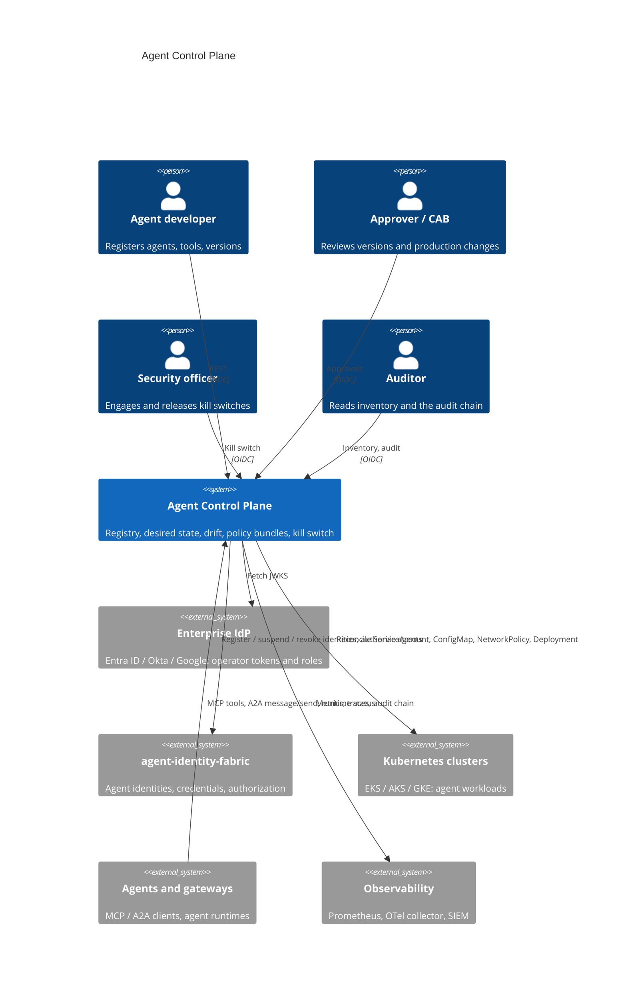
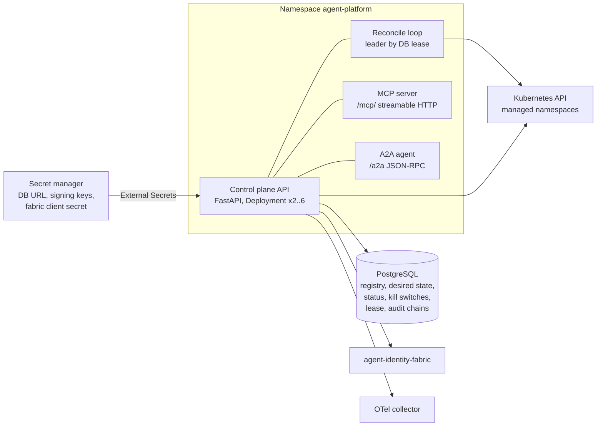
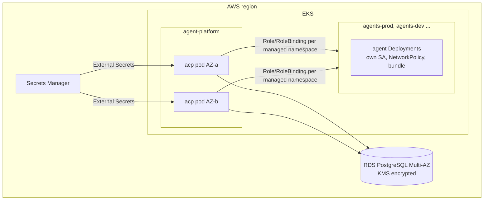

# Architecture

## Business problem

Enterprises now run agents built with several frameworks (LangGraph, CrewAI,
AutoGen, Google ADK, Microsoft Agent Framework, AWS Strands), owned by
different teams, on shared Kubernetes estates and increasingly on managed
agent runtimes. Without a control plane, nobody can answer basic questions
with evidence: which agents exist and who owns them, which build is running
where and who approved it, which tools each one may call, what policy it runs
under, whether what is running still matches what was approved, and how to
stop one, or all of them, immediately.

The control plane answers those questions and enforces the answers:

```
Registry ─▶ Identity ─▶ Policy ─▶ Runtime ─▶ Observability
(versions,   (workload    (signed     (desired state    (status, drift,
 owners,      identity     bundles,    reconciled to     audit chain,
 risk,        per deployed approvals,  Kubernetes, kill  metrics, traces)
 lifecycle)   version)     kill switch) switch, adapters)
```

## System context (C4 level 1)



## Containers (C4 level 2)



## Components (C4 level 3)

| Layer | Module | Responsibility |
|---|---|---|
| API | `api.routes`, `api.app` | Operator REST, correlation IDs, metrics, OAuth-style errors |
| API | `api.mcp_server` | MCP tools (official `mcp` SDK `MCPServer`), typed schemas, authorization, audit |
| API | `api.a2a` | Agent Card, JSON-RPC `message/send` dispatch to the same operations |
| Application | `application.registry` | Agents, versions, tools, lifecycle, two-person approvals |
| Application | `application.bundles` | Policy bundle validation, digest, Ed25519 signature |
| Application | `application.deployments` | Desired state, approval of production changes, identity per version |
| Application | `application.killswitch` | Durable kill switches, identity suspension, immediate reconcile |
| Application | `application.operations` | Agent-facing operations shared by MCP and A2A |
| Application | `application.governance` | Callers, policy decisions, audit recording |
| Domain | `domain.models`, `domain.ports` | Aggregates, lifecycle state machine, repository and gateway ports |
| Orchestration | `orchestration.manifests` | Render hardened objects for a revision (and its killed variant) |
| Orchestration | `orchestration.drift` | Subset diff with strict security paths |
| Orchestration | `orchestration.reconciler` | Reconcile, detect drift, leader-gated loop |
| Infrastructure | `infrastructure.database` | SQLAlchemy Core repositories, lease, SQL audit sink |
| Infrastructure | `infrastructure.kubernetes` | `ClusterGateway` on the official Kubernetes client |
| Integrations | `integrations.identity_fabric` | Fabric client, authorizer, identity registrar, client-credentials tokens |
| Security | `security.*` | OIDC verification, local policy gate, signing keys, content screening |
| Adapters | `adapters.*` | Run contract, six framework adapters, `PlatformRunner` for agent images |
| Runtime | `runtime.container` | Composition root |

## Sequences

### Register, review, deploy

```mermaid
sequenceDiagram
  participant D as Developer
  participant A as Approver(s)
  participant P as Deployer
  participant C as Control plane
  participant F as Identity fabric
  participant K as Kubernetes API
  D->>C: POST /v1/agents, /v1/tools, /v1/agents/{ns}/{n}/versions
  D->>C: transition submit
  A->>C: transition approve (policy: SoD; two approvers for HIGH/CRITICAL)
  P->>C: POST /v1/deployments (production + HIGH risk => 202 approval_required)
  A->>C: POST /v1/deployments/{name}/approve (approver != requester)
  C->>F: POST /v1/agents (identity <deployment>-<version>, bound to SA + image digest)
  C->>K: create/replace ServiceAccount, ConfigMap (signed bundle), NetworkPolicy, Deployment
  C-->>A: status Available (audited)
```

### Drift and correction

```mermaid
sequenceDiagram
  participant L as Reconcile loop (leader)
  participant K as Kubernetes API
  participant DB as PostgreSQL
  loop every interval or on trigger
    L->>DB: acquire lease
    L->>K: read four objects per deployment
    L->>L: render desired; diff (subset + strict paths)
    alt same spec hash but different => drift
      L->>K: replace with resourceVersion
      L->>DB: status corrected=true; audit deployment.drift_corrected
    else different spec hash => rollout
      L->>K: create/replace
    end
  end
```

### Kill switch

```mermaid
sequenceDiagram
  participant S as Security officer or SOAR agent
  participant C as Control plane
  participant F as Identity fabric
  participant K as Kubernetes API
  S->>C: POST /v1/kill-switches (or MCP engage_kill_switch / A2A skill)
  C->>C: authorize; persist KillSwitch (durable)
  C->>F: POST /v1/suspend (credential epoch bump: every token dies)
  C->>K: Deployment replicas 0; NetworkPolicy deny-all
  C-->>S: affected deployments, phases Killed
  Note over C: every later reconcile renders the killed variant until a different officer releases
```

## Deployment view (AWS reference)



Replicas spread across zones; the PDB keeps one available; the HPA scales
2–6 on CPU. Only the lease holder runs the periodic loop; any replica serves
API-triggered reconciles (per-deployment locks and resourceVersion protect
concurrent writers). Terraform for Azure (PostgreSQL Flexible Server
zone-redundant, Key Vault) and GCP (Cloud SQL regional, Secret Manager with
CMEK) provisions the same shape. See
[deployment targets](deployment-targets.md) for Amazon Bedrock AgentCore.

## Observability

| Signal | Source |
|---|---|
| Metrics | `/metrics`: request latency, reconcile duration/errors, drift by kind/change, deployments by phase, kill switches active, authorization decisions by surface, MCP tool calls, A2A requests, leader, cluster reachability |
| Traces | OpenTelemetry (FastAPI instrumentation, OTLP export) |
| Logs | JSON via agentic-core structlog with correlation IDs and secret scrubbing |
| Audit | agentic-core hash-chained, Ed25519-signed events in PostgreSQL, one chain per replica, verifiable at `/v1/audit/verify` |
| Alerts | `configs/prometheus/alerts.yaml` |
| Dashboard | `configs/grafana/agent-control-plane.json` |

## CI/CD

`ci.yml`: ruff, black, mypy `--strict`, bandit, contract drift check, tests
(unit, security, chaos, performance, e2e incl. schemathesis; coverage gate
90%) on Python 3.12 and 3.13; PostgreSQL integration; Helm lint/render with
required-values check and kubeconform; Terraform fmt/validate for AWS, Azure,
GCP; Trivy IaC scan; container build, smoke test (ready, agent card, MCP
tools/list, 401 on the API, non-root), Trivy image scan, Syft SBOM, Grype gate;
Semgrep. `release.yml` on `v*.*.*`: the same quality gate, image to GHCR with
SBOM and provenance attestation, Helm chart to GHCR OCI, GitHub release.

## Cost and scalability

| Driver | Behaviour | Guidance |
|---|---|---|
| Reconcile load | 4 GETs per deployment per interval (writes only on change) | 500 deployments at 30 s ≈ 67 req/s to the API server; raise the interval or shard by managed namespace beyond that |
| Database | Small documents; audit rows grow with activity | db.r6g.large / D4ds_v5 / 4 vCPU covers thousands of deployments; partition `audit_events` by month at high volume |
| API replicas | Stateless; CPU-bound on JWT verification | HPA 2–6 |
| Identity fabric | One registration per deployed version; suspend/reinstate on kill | Negligible |

## Acceptance criteria

| # | Criterion | Evidence |
|---|---|---|
| AC1 | Only approved versions with approved tools deploy | `tests/unit/test_deployments.py`, `test_registry.py` |
| AC2 | HIGH/CRITICAL versions need two distinct approvers; nobody approves their own work | `test_registry.py`, `tests/security` T3/T4 |
| AC3 | Production changes to HIGH/CRITICAL agents need an approver other than the requester | `test_deployments.py`, T14 |
| AC4 | Desired state is reconciled to ServiceAccount, ConfigMap, NetworkPolicy and Deployment via the official Kubernetes client | `test_deployments.py`, `test_kubernetes.py` |
| AC5 | Out-of-band changes are detected without changes (`/drift`) and corrected on reconcile | `test_reconciler.py`, T8/T9 |
| AC6 | Kill switch stops target(s) within one request, suspends identities, survives redeploys, needs a second person to release | `test_killswitch.py`, T6/T7, chaos |
| AC7 | Each deployed version has its own fabric identity bound to its service account and image digest; superseded identities are revoked once the rollout is available | `test_deployments.py`, `test_identity_fabric.py` |
| AC8 | Policy bundles are validated, signed, immutable, and delivered to workloads | `test_bundles.py`, `test_manifests.py` |
| AC9 | Six framework adapters implement the run contract | `test_adapters.py` |
| AC10 | MCP tools and A2A skills authorize every call and audit it | `tests/e2e/test_mcp_a2a.py` |
| AC11 | Every decision and state change is in a verifiable signed audit chain | `test_http_lifecycle.py` |
| AC12 | No generated API input causes a 5xx | `tests/e2e/test_api_contract.py` |
